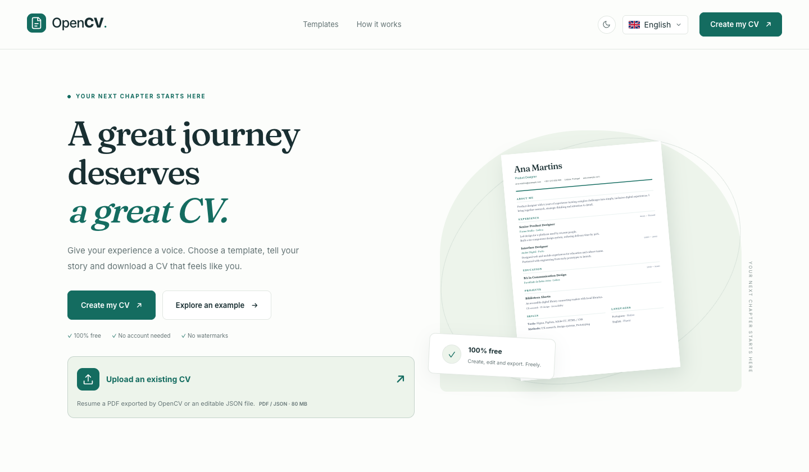
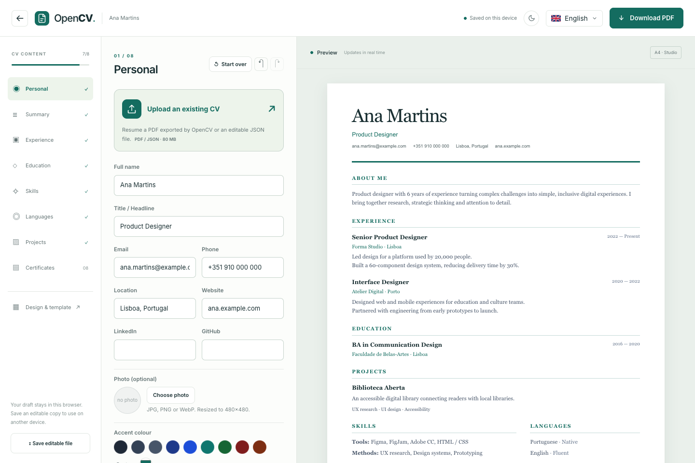
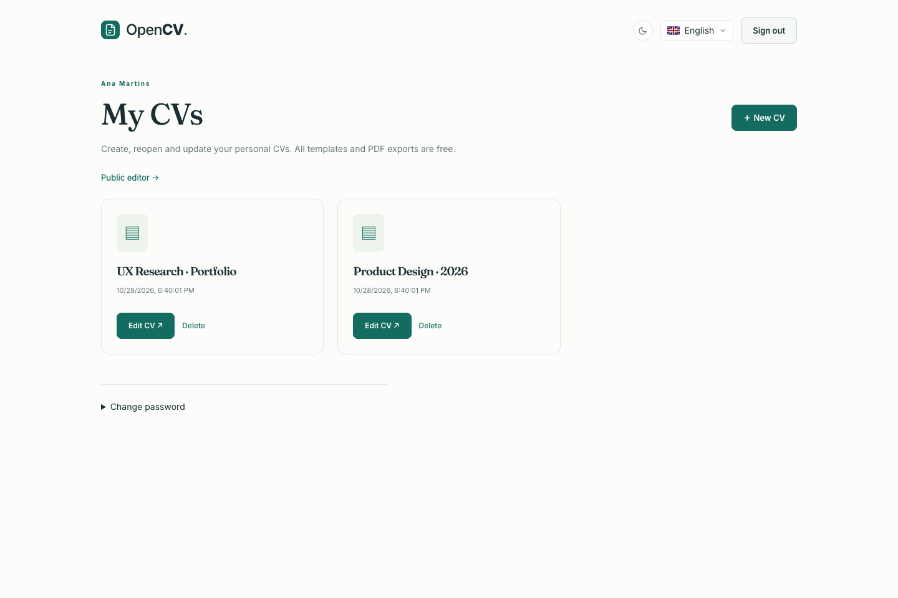
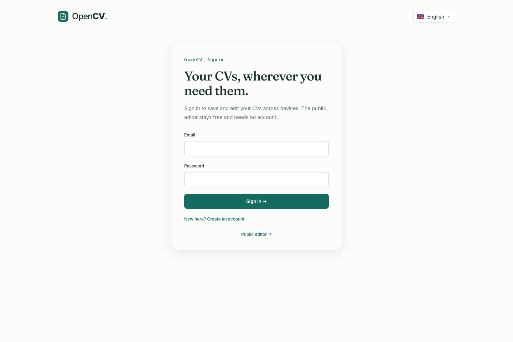
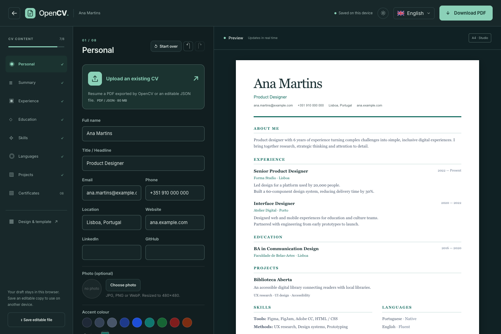
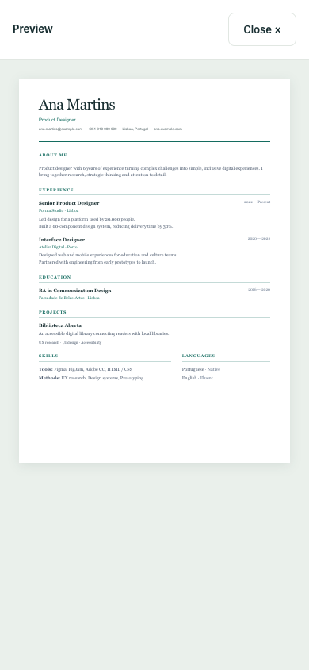

# OpenCV

A free CV builder with a live preview, nine templates, and editable PDF exports. No paywall or watermark. No account required.

Build a CV from scratch, explore an example, or upload an existing OpenCV PDF or JSON file to keep editing. Use the public editor without signing in, or create an account to save a personal CV library. Run the entire application in a single Docker container.

[GitHub repository](https://github.com/Tomasneto404/OpenCV) · [Docker Hub](https://hub.docker.com/r/tomasneto26/opencv) · [Deployment guide](DEPLOY.md)

> This project is a CV builder and is not affiliated with the OpenCV computer vision library.

## Screenshots

### Landing page

Choose a template, start a new CV, or upload an existing one.



### Editor and live preview

Edit each section, change the design, and preview your CV alongside the form.



### Optional account library

Keep your saved CVs together, reopen them for editing, or continue using the public editor.



<details>
<summary>Sign-in screen</summary>



</details>

<details>
<summary>Dark mode and mobile preview</summary>

### Dark mode



### Mobile preview

<p align="center">
  
</p>

</details>

Screenshots show the running application in English using the built-in sample CV.

## Quick start with Docker

Download [compose.yaml](compose.yaml) into a directory on your server, then run:

```sh
docker compose up -d --wait
```

Open **http://localhost:8080**.

The compose file pulls `tomasneto26/opencv:latest` from Docker Hub. One Node.js container serves both the interface and the API. Accounts, sessions, and saved CVs use SQLite in the `opencv-data` volume. There is no separate database container, and PDFs still need no keys.

To use the current version explicitly:

```sh
IMAGE_TAG=0.1.0 docker compose up -d --wait
```

Set `WEB_PORT` to change the published port. For example:

```sh
WEB_PORT=80 docker compose up -d --wait
```

To build the image from your local checkout:

```sh
docker compose -f docker-compose.yml up -d --build --wait
```

Images are published for `linux/amd64` and `linux/arm64`, tagged with `latest`, the version from `package.json`, and the full commit SHA. See [DEPLOY.md](DEPLOY.md) for deployment and migration instructions.

## Local development

Requires **Node.js 22.13 or later** and npm.

```sh
npm run install:all
npm run dev
```

- Application: http://localhost:5173
- API health check: http://localhost:3001/health
- Press `Ctrl+C` to stop both processes.

An `.env` file is optional. See [.env.example](.env.example) to configure ports, PDF concurrency, and proxy settings. Vite reads the root `.env` and forwards `/api` to the local API. If you change `PORT`, update the proxy target in [client/vite.config.ts](client/vite.config.ts) as well.

## Optional accounts and SSO

The public editor, all templates, JSON import, and PDF downloads stay free and available without login.

- Register with an email and password, or sign in through a configured OpenID Connect provider.
- Open **My CVs** to create, edit, duplicate, rename, and delete your saved CVs.
- Use **Save to account** in the public editor to add an existing draft to your library.
- Account CVs use explicit **Save changes** and remain separate from the public browser draft. Unsaved edits prompt before leaving; conflicting updates from another tab are rejected rather than overwritten.
- Sign out without leaving private CV contents in the public draft. Change your local password from **My CVs** to invalidate other sessions.

Set `APP_URL` to the application's public URL. For SSO, configure `OIDC_ISSUER`, `OIDC_CLIENT_ID`, and `OIDC_CLIENT_SECRET`, with redirect URI `<APP_URL>/api/auth/sso/callback`. `OIDC_LABEL` controls the button label. Without those credentials, local login and the public editor work normally and the SSO button is hidden.

SSO uses OpenID Connect discovery, authorization code flow, PKCE, state, nonce, and signed ID-token validation. Accounts are identified by issuer and subject; a matching email never automatically links an SSO identity to a local account. This supports standard OIDC providers such as Authentik and Keycloak; see [DEPLOY.md](DEPLOY.md) for configuration.

Local passwords are hashed with scrypt, and sessions use HttpOnly, SameSite cookies (Secure when `APP_URL` uses HTTPS). There is no email service or password-reset email: keep local credentials safe, or use your identity provider's recovery flow for SSO accounts.

## Features

- **Nine templates:** Modern, Classic, Minimal, Creative, Executive, Compact, Studio, Technical, and Academic.
- **Live preview:** independently scrollable pages alongside the editor, with a dedicated mobile preview.
- **Personalization:** accent colors, profile photos, light and dark themes, and a responsive layout.
- **Five interface languages:** Portuguese, English, Spanish, French, and German.
- **Complete CV sections:** personal details, summary, experience, education, skills, languages, projects, and certificates.
- **Free PDF exports:** direct downloads without accounts, checkout, watermarks, or email delivery.
- **Upload and resume:** import OpenCV PDFs or editable JSON files from the landing page or editor, with confirmation before replacing a draft.
- **Local drafts:** automatic browser storage, JSON backups, undo/redo, and a reset action with confirmation.
- **PDF certificates:** up to 10 MB per file and 50 MB in total, with optional framing and every page preserved.

Drafts are stored in your browser's `localStorage`. If saving fails, the editor displays a warning so you can download an editable JSON backup. Imported data is validated before it reaches the editor.

## Data and editable PDFs

Public imports and PDF exports are processed in memory without storing those drafts or generated PDFs on disk. CVs explicitly saved to an account are stored in SQLite with their owner and can be deleted from the library. The application has no payment, email, sales notification, or analytics integrations.

Every exported PDF includes an **`opencv.json` attachment** containing the editable CV data. It is neither encrypted nor signed: you can reimport it into any OpenCV installation, without keys or access to the server that created it. Anyone who receives the PDF can also read its embedded data.

PDFs from other applications that do not contain OpenCV's editable data cannot be imported. You can also save and import a standalone JSON backup.

Older PDFs with encrypted `cveaver.dat` or `opencv.dat` attachments must be opened in the previous version to save a JSON backup. Import that JSON into the current version. Drafts and preferences saved under the previous application name are still recognized in the same browser.

The HTML preview and PDF export use different renderers, so pagination may vary. Check the exported PDF before sharing it. Compact reduces spacing rather than cutting content to force a single page.

## Tests and validation

```sh
npm run build                   # Client build and TypeScript checks
npm test                        # Validation, portability, templates, and PDF round trips
npx playwright install chromium # Install the browser before the first E2E run
npm run test:e2e                 # Desktop and mobile browser tests
```

Unit tests cover all nine templates, long CVs, editing after reimport, reading PDFs in a separate process without keys, multipage certificates, rejection of invalid data, account ownership, password and session handling, concurrent edit conflicts, database persistence, and SSO success/failure paths with a local test identity provider.

Browser tests start development servers when needed. They cover JSON/PDF upload, invalid files, replacement and cancellation, draft persistence, reset and undo, long-preview scrolling, the developer Easter egg, account registration/login/logout, saved CV editing, and separation from public drafts.

To test a running Docker deployment:

```sh
E2E_BASE_URL=http://localhost:8080 npm run test:e2e
```

[GitHub Actions](https://github.com/Tomasneto404/OpenCV/actions) runs the browser tests against the actual Docker container. Images are published to `tomasneto26/opencv` only after the build, type checks, tests, and secret scan pass.

## API

The application uses the `/api` prefix in production and through the Vite development proxy. The standalone development API also accepts the same routes without that prefix.

| Method | Endpoint | Description |
| --- | --- | --- |
| GET | `/api/health` | Service health |
| POST | `/api/pdf` | Accepts `{ cv }` and returns a PDF |
| POST | `/api/decode-pdf` | Accepts an `application/pdf` body and returns validated CV data |

Account endpoints include `/api/auth/session`, `/api/auth/register`, `/api/auth/login`, `/api/auth/logout`, `/api/auth/password`, and `/api/auth/sso`. `/api/cvs` supports authenticated listing/creation, while `/api/cvs/:id` supports reading, updating, and deleting an owned CV. Updates and deletes require the current `revision` to detect conflicts. Mutating account requests require `X-OpenCV-Request: 1` and a matching Origin when supplied; the UI also sends `X-OpenCV-User` to detect account switches in other tabs.

The API limits request rates and concurrent PDF generation. The request body limit is 80 MB to accommodate base64-encoded attachments.

## Project structure

| Path | Purpose |
| --- | --- |
| `client/` | React, TypeScript, Vite, Tailwind, the editor, and HTML preview |
| `server/` | Express API, accounts and SQLite storage, OIDC, static hosting, PDF generation, and import |
| `shared/` | CV types and validation shared by the client and server |
| `tests/e2e/` | Playwright desktop and mobile tests |
| `docs/screenshots/` | Screenshots used in this README |
| `Dockerfile` | Builds the interface and packages the single application container |
| `compose.yaml` | Production deployment using Docker Hub images |
| `docker-compose.yml` | Local container builds |

## Credits

Developed with care by [Tomás Neto](https://github.com/Tomasneto404).

Enter the Konami code outside a text field to reveal the developer Easter egg: **↑ ↑ ↓ ↓ ← → ← → B A**.

## License

© 2026 Tomás Neto. All rights reserved.
